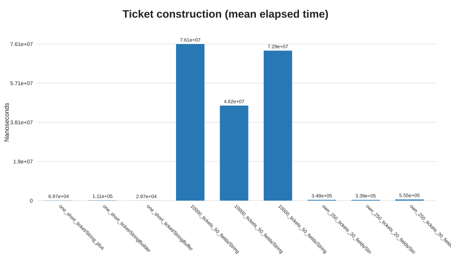

# Q1 - Railway ticket text construction

## Prediction (written before consulting the measurements)

For a tiny ticket, all three choices should be usable and measurement noise may dominate. Across 10,000 tickets with 50 fields each, repeated `String` concatenation should allocate many more intermediate strings and take longer than a reusable `StringBuilder`. `StringBuffer` should have similar growth but some synchronization overhead. For an individual ticket I predict `StringBuilder`; for a shared log, `StringBuffer` is safe only when each complete record is appended with one synchronized call (or when the caller synchronizes the whole record).

## Design and implementation

`StringConstructionBench.java` generates railway-like fields (PNR, passenger, coach, berth, fare, origin, destination, and journey date) with `String +`, `StringBuilder`, and `StringBuffer`. Workloads are one 8-field ticket, 10,000 50-field tickets, and my additional 250 20-field workload. There are three warm-ups and twelve timed runs per case. CSV memory columns are `Runtime` heap-used snapshots; they are noisy snapshots, not allocation-profiler measurements. Estimated intermediate-string counts are model-based: one concatenation result per field for `+`, and one finished ticket string per ticket for the mutable builders.

The shared-log demonstration starts four threads and appends 1,000 whole records to one `StringBuffer`, then verifies the record count.

## Measured results

Elapsed time in nanoseconds (average; min-max across 12 timed runs):

| Workload | String + | StringBuilder | StringBuffer |
|---|---:|---:|---:|
| One short ticket | 69,658 (39,800-214,200) | 111,067 (18,300-952,100) | 29,683 (20,600-60,900) |
| 10,000 x 50 fields | 76,107,617 (42,228,300-216,633,700) | 46,182,183 (34,322,000-63,018,500) | 72,895,142 (53,926,100-115,809,900) |
| 250 x 20 fields | 348,067 (292,700-549,200) | 339,158 (229,500-942,000) | 555,300 (409,600-735,300) |

Raw per-run times, estimated string counts, and heap snapshots are in [Q1-results.csv](./Q1-results.csv). The string-count estimate covers assembly-result strings, not field-value construction or the shared final aggregation buffer. The threaded test reported 1,000 complete records.

## Prediction versus observation and analysis

The large workload supports the prediction: `String +` took about 1.65 times the `StringBuilder` average. The custom workload was nearly tied between those two approaches, while the short case had a large StringBuilder outlier and favored StringBuffer in this run. Small-workload rankings are especially noisy; use the growth/allocation reasoning for the choice rather than treating those values as universal.

With `F` fields and total output length `L`, concatenating each growing prefix copies roughly `1 + 2 + ... + F` field-sized prefixes, or `O(F^2)` copied characters for similarly sized fields. A builder grows geometrically and appends the characters in amortized `O(L)` time. Each builder needs `O(L)` backing storage. Repeated concatenation creates `O(F)` intermediate String results per ticket (and copies prefixes); the builder creates a final String per ticket plus its mutable buffer. These estimated counts are not VM allocation counts.

**Decision:** use `StringBuilder` for each ticket. Use `StringBuffer` for a simple shared log only when each whole record is appended in one call. If records require several append calls, synchronize the complete record or use a single-writer queue/concurrent logging design; per-call synchronization alone does not make a multi-call record atomic.

## Alternative concept and complexity analysis

`String.join(delimiter, fields)` or `StringJoiner` express delimiter-separated fields cleanly and remain linear in the output length. `String.format` is readable for fixed templates and locale-sensitive values, but formatting/parsing overhead makes it a less attractive high-volume path. None removes the need to hold the finished output, so output space is `O(L)`; joiners/builders also need a mutable buffer while assembling it.
