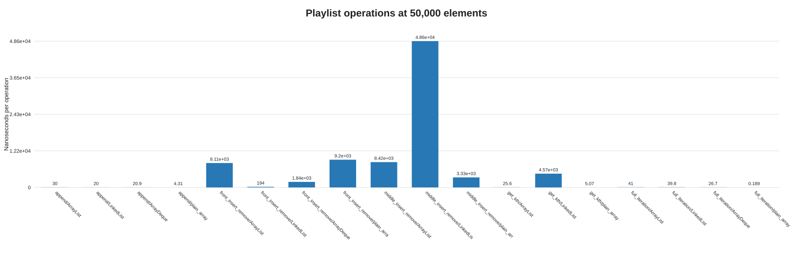

# Q2 - Playlist collections

## Prediction (written before consulting the measurements)

`ArrayList` and a plain array should have constant-time indexed reads and good iteration locality. `ArrayList` front/middle edits and manual-array edits shift elements. `LinkedList` and `ArrayDeque` should handle front operations without shifting; a linked list should not automatically win at the middle because locating an index is linear. For an "Up Next" queue with additions at both ends and removal at the front, I predict `ArrayDeque`.

## Design and implementation

`PlaylistBench.java` measures sizes 1,000, 10,000, and 50,000, with two warm-ups and ten measured runs for each case. CSV rows retain elapsed time and per-operation time. Append constructs a collection; front/middle insert-remove performs 100 pairs; indexed reads perform 10,000 reads for arrays/lists and 100 reads for `LinkedList` (each read counts as one operation); iteration visits all elements. The linked-list middle case includes finding the middle iterator each time. The primitive `int[]` is a baseline, not a fully equal comparison to collections holding boxed `Integer` references.

## Measured results

Average nanoseconds per operation at size 50,000:

| Operation | ArrayList | LinkedList | ArrayDeque | Plain int array |
|---|---:|---:|---:|---:|
| Append | 30.02 | 20.01 | 20.91 | 4.31 |
| Front insert + remove | 8,108.70 | 194.50 | 1,841.80 | 9,202.55 |
| Middle insert + remove | 8,422.25 | 48,615.25 | Not supported | 3,325.10 |
| k-th read | 25.59 | 4,565.60 | Not supported | 5.07 |
| Full iteration, per item | 41.05 | 39.84 | 26.72 | 0.19 |

`ArrayDeque` intentionally has no indexed access or middle-insertion operation. Full per-run data for all sizes and min/max times are in [Q2-results.csv](./Q2-results.csv).

The CSV also stores operation counts, approximate container-object counts (for example one linked-list node per element), and Runtime heap snapshots. They exclude per-element boxed values and remain VM/GC-dependent.

## Prediction versus observation and analysis

The measurements agree with the central predictions: random access favors contiguous storage, while linked-list front changes avoid element shifts. At 50,000 items, `LinkedList` front insert/remove was much cheaper than the shifting list/array cases, but linked-list indexed reads and middle edits were far slower because traversal is part of the operation. For a real playlist, `ArrayList` remains a sensible default when random access, iteration, and append dominate and edits are infrequent. Stop recommending it when front/middle insertions routinely shift a large suffix and those costs breach the application's latency budget; choose `LinkedList` only if its node overhead and traversal trade-offs fit the access pattern.

For **Up Next**, `ArrayDeque` directly represents both-end additions and front removal (`addFirst`/`addLast`/`removeFirst`) with amortized `O(1)` operations and no per-element linked-list node. It is not a general indexed playlist.

Approximate space per element on a 64-bit HotSpot VM with compressed references (implementation-dependent):

| Structure | Approximate element storage |
|---|---|
| ArrayList | about 4-byte reference in backing array, plus spare capacity; referenced object is separate |
| LinkedList | reference plus roughly 24-byte node overhead per element (alignment/VM-dependent), plus referenced object |
| ArrayDeque | about 4-byte reference in circular backing array, plus spare capacity; referenced object is separate |
| `int[]` | 4 bytes per primitive integer, with no boxing or node |

## Alternative concept and complexity analysis

Appending is amortized `O(1)` for array-backed structures and `O(1)` for linked lists; indexed get is `O(1)` for `ArrayList`/array and `O(n)` for `LinkedList`. Front edits are `O(n)` for array-backed lists/arrays and `O(1)` for linked structures/deques. Middle list/array insertion is `O(n)` due to traversal or shifting; `ArrayDeque` does not expose this operation. Iteration is `O(n)` for all four. A manual array can be compact and fast for read-heavy fixed-size data, but its capacity management and shifts are the programmer's responsibility.
