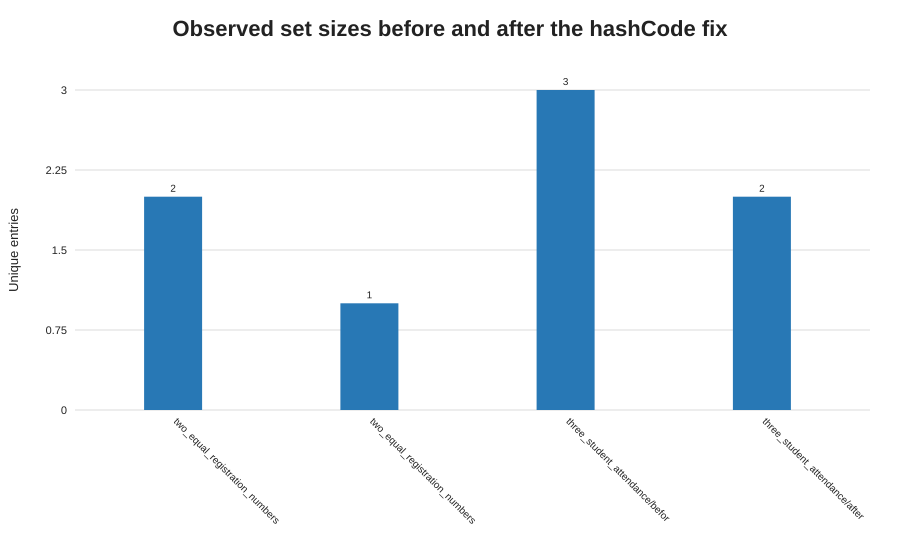

# Q3 - HashSet equality and hashing

## Prediction (written before consulting the output)

With `equals` based on registration number but no matching `hashCode`, two distinct objects with the same registration number may be placed in different hash buckets, so the set can keep both. Inserting the same reference twice should appear to work because the set sees the same object. After implementing `hashCode` with `Objects.hash(regNo)`, equal registration numbers should share a hash and `equals` should reject the duplicate; the supplied attendance example should then report two unique students. Mutating `regNo` while the object is stored should make hash-based lookup unreliable even after the fix.

## Design and implementation

`Attendance.java` deliberately runs a small `StudentBeforeFix` model first, then uses the completed [Student.java](./Student.java). `Student.equals` and `Student.hashCode` both use `regNo`; the hash is exactly `Objects.hash(regNo)`. The program tests the same reference twice, distinct students with equal registration numbers, the provided three-student attendance example, and a mutation of a stored student's registration number.

## Measured results

| Test | Before TODO | After TODO |
|---|---:|---:|
| Same object added twice | 1 | 1 |
| Two different objects, same registration number | 2 | 1 |
| Attendance input CSA001, CSA001, CSA002 | 3 | 2 |
| Mutated stored registration lookup | Not applicable | `contains` is false |

The completed attendance output is **`Unique students: 2`**. The baseline intentionally records three because it violates the equals/hashCode contract. See [Q3-output.txt](./Q3-output.txt) and [Q3-results.csv](./Q3-results.csv).

## Prediction versus observation and analysis

All three predictions matched. A `HashSet` first uses `hashCode` to select a bucket, then uses `equals` to distinguish candidates within that bucket. Equal objects must have equal hashes. `equals` alone cannot force the set to compare objects in separate buckets, which explains why the faulty baseline can retain duplicates.

Changing a field used by `equals`/`hashCode` changes the object's bucket calculation after insertion; the set does not move the stored reference. A later lookup can search a different bucket and fail. Prefer immutable key fields, or remove the object before changing the key and reinsert it. Verification: add two distinct students with the same registration number and assert set size 1; the completed example prints size 2 for the two distinct registration numbers.

## Alternative concept and complexity analysis

With a correctly distributed `hashCode`, `HashSet` add/contains/remove are average `O(1)` and use `O(n)` storage, with `O(n)` worst cases under collisions. A `TreeSet` using `Comparator.comparing(Student::regNo)` provides ordered uniqueness in `O(log n)` per operation and `O(n)` storage, but the comparator must define identity consistently with the intended equality. A `HashMap<String, Student>` keyed by immutable registration-number strings also offers average `O(1)` lookup and makes the uniqueness key explicit; it uses `O(n)` entries plus key/value references.
