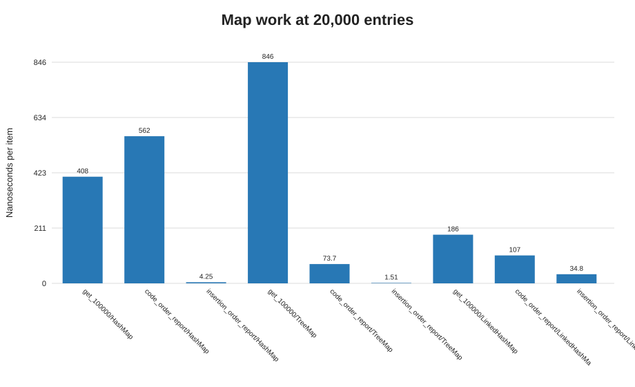

# Q4 - Pharmacy inventory map choice

## Prediction (written before consulting the measurements)

`HashMap` should offer average constant-time lookup but no useful iteration order. `TreeMap` should keep medicine codes sorted at `O(log n)` lookup and produce code-order reports without a sort. `LinkedHashMap` should preserve insertion order and produce that report directly. Since the pharmacy needs both code-order and insertion-order reports, I predict `LinkedHashMap`, sorting a copy only when a code-order report is requested.

## Design and implementation

`PharmacyMapBench.java` compares `HashMap`, `TreeMap`, and `LinkedHashMap` at 100, 5,000, and 20,000 medicines. Insertion order is deliberately reverse code order so the two reports differ. It records twelve timed runs after warm-up for puts, 100,000 precomputed-key lookups, and each report. Report order is checked on every run. Precomputing lookup keys keeps string formatting outside the timed lookup.

## Measured results

At 20,000 entries, average nanoseconds per item/lookup across the twelve runs:

| Map | Lookup | Code-order report | Insertion-order report |
|---|---:|---:|---:|
| HashMap | 407.57 ns/lookup | 562.42 ns/entry | 4.25 ns/entry |
| TreeMap | 845.51 ns/lookup | 73.66 ns/entry | 1.51 ns/entry* |
| LinkedHashMap | 186.00 ns/lookup | 106.67 ns/entry | 34.77 ns/entry |

The report columns include returning the ordered code list; a `TreeMap` report reads sorted keys directly. `*` For a non-LinkedHashMap, the program uses its separately retained insertion-order list to produce the insertion report. All map/order combinations passed the correctness check at all three sizes. See [Q4-results.csv](./Q4-results.csv).

The raw CSV includes operation counts, estimated map-structure object counts, and Runtime heap snapshots. Estimates exclude key/value objects and are not profiler measurements.

## Prediction versus observation and analysis

All three maps were below the chosen acceptable mean lookup target of **10 microseconds (10,000 ns) per lookup**; observed means were below 1 microsecond in this run. `LinkedHashMap` offers the simplest dual-report design: insertion-order iteration is direct; code-order reports sort a copy (`O(n log n)`). The large-size lookup numbers are noisy and should not be treated as a universal ranking of implementations. The remaining lookup cost comes from hashing/tree navigation, key equality, cache behavior, and benchmark/runtime overhead.

If code-order reports dominate and insertion order is still required, `TreeMap` plus an insertion-order list is reasonable: it gives sorted traversal, but it stores extra ordering information. A plain `HashMap` requires a list for insertion order and a sorted copy for code order. `Hashtable` is not preferred for this modern design: it is a legacy synchronized map with no useful ordering, synchronization can bottleneck concurrent access, and `ConcurrentHashMap` is the usual concurrent choice when ordering is not required.

## Alternative concept and complexity analysis

A sorted array can provide `O(log n)` lookup via `Arrays.binarySearch` and `O(n)` code-order iteration. Inserting a new medicine into sorted position requires `O(n)` shifting; a separate insertion-order sequence is needed to preserve arrival order. Its dense storage can be space-efficient for mostly static inventories. `HashMap` has average `O(1)` put/get and `O(n)` iteration; `TreeMap` has `O(log n)` put/get and `O(n)` sorted iteration; `LinkedHashMap` has average `O(1)` put/get plus order links and `O(n)` ordered iteration. Each stores `O(n)` entries; tree and linked entries have more per-entry overhead than a flat array.
