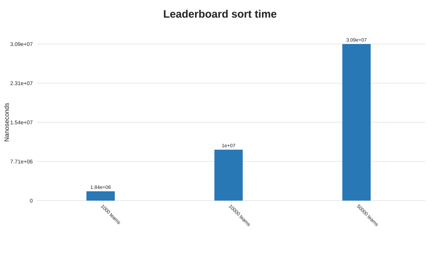

# Q5 - Generic leaderboard ranking

## Prediction (written before consulting the measurements)

One comparator chain should rank by points descending, goal difference descending, and name ascending, while leaving the source list unchanged. A subtraction-based descending comparator can overflow for extreme `int` values. If the comparator is transitive and returns zero for teams equal on all ranking fields, sorting a copied list should be correct and run in `O(n log n)`.

## Design and implementation

`LeaderboardDemo.java` defines `Leaderboard<T extends Team>`. `ranking(List<? extends T>)` copies the input to a new `ArrayList` and sorts only the copy. A `Comparator<Team>` composes the three ranking keys. The bounded type limits ranking to teams (and subtypes), while `? extends T` accepts a list of any subtype without allowing unsafe additions to that source list.

The program checks the requested four-team output, verifies that the input order is preserved, exercises ties at all ranking levels, checks comparator reflexivity/sign symmetry/transitivity on the tie data, and contrasts with a faulty subtraction comparator on integer extremes.

## Measured results

Average sort times in nanoseconds (12 runs after three warm-ups):

| Teams | Average | Min | Max |
|---:|---:|---:|---:|
| 1,000 | 1,836,233 | 527,600 | 6,557,600 |
| 10,000 | 10,034,642 | 3,809,400 | 14,994,700 |
| 50,000 | 30,852,333 | 26,382,800 | 34,923,100 |

Expected output: `[Eagles(9,6), Bisons(9,4), Panthers(9,4), Cobras(6,1)]`. Bisons is before Panthers because points and goal difference tie, and `"Bisons"` sorts before `"Panthers"`. The overflow test placed `Minimum` first with the faulty comparator but `Maximum` first with the correct comparator. Raw data are in [Q5-results.csv](./Q5-results.csv).

The CSV records the team count as operations, estimated auxiliary reference slots (`n` copied references plus up to about `n/2` TimSort temporary references), and Runtime heap snapshots. The reference count is a sizing estimate, not an object profiler.

## Prediction versus observation and analysis

The expected order, tie behavior, source-list immutability, and overflow failure were observed. Correctness follows from lexicographic comparison: first compare points in descending order; only a tie reaches descending goal difference; only another tie reaches ascending name. Each constituent comparator is transitive, and lexicographic composition preserves transitivity. Using comparator helpers avoids arithmetic overflow. The comparator returns zero exactly when all three ranking fields compare equal.

## Alternative concept and complexity analysis

If `Team` implemented `Comparable<Team>`, it would impose one default ranking on every use of the model. A `Comparator` is more reusable when the same team may be ranked by points, name, or season-specific rules. Three stable sorts (name ascending, then goal difference descending, then points descending) can produce the same result, but perform three `O(n log n)` sorts instead of one and are less direct. The current sort costs `O(n log n)` time, `O(n)` for the copied list, and up to `O(n)` temporary reference storage in the sorting implementation; it never rearranges the caller's list.
