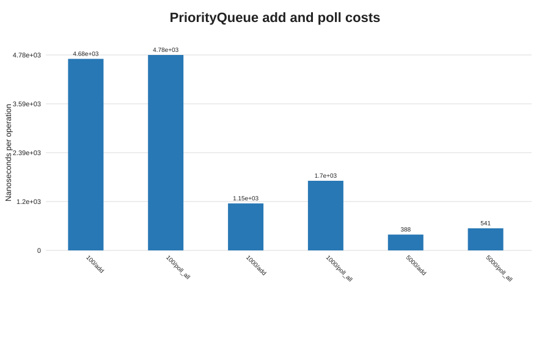

# Q6 - Emergency triage priority queue

## Prediction (written before consulting the measurements)

A FIFO `Queue` cannot select a more urgent patient who arrived later, so it is insufficient for triage. A `PriorityQueue` ordered by ascending severity number and then ascending arrival counter should return the most urgent patient and preserve FIFO order within a severity. Add and poll should scale as `O(log n)`. Without aging, an unending stream of severity-1 arrivals can indefinitely delay a severity-5 patient.

## Design and implementation

`TriageDemo.java` builds a `PriorityQueue` with the required comparator. It polls a **copy** to display the treatment order, because printing a priority queue's internal heap is not a sorted traversal; the original queue is then polled to show actual treatment order. The six-patient example and a hand-checkable eight-patient case are printed.

The separate `AgingTriage` design uses five `TreeSet` severity lanes ordered by arrival counter and a priority queue of scheduled promotion times. At each due time a waiting patient moves up one severity band; at severity 1 promotion stops. A poll applies due promotions before selecting a lane. Thus the comparator does not depend on clock time changing underneath an existing heap.

## Measured results

Expected removal sequence was verified exactly:
`Meena(S1) Kumar(S1) Lata(S2) Ravi(S3) John(S3) Asha(S5)`.

PriorityQueue batch measurements (average nanoseconds per add/poll operation; twelve runs after three warm-ups):

| Patients | Add average (min-max) | Poll-all average (min-max) |
|---:|---:|---:|
| 100 | 4,685 (734-35,025) | 4,781 (405-37,692) |
| 1,000 | 1,148 (459-5,954) | 1,702 (339-14,749) |
| 5,000 | 388 (177-1,113) | 541 (365-1,175) |

In the simulated waiting scenario, static priority served `Urgent-1` instead of the waiting severity-5 patient; after 5,000 ms of aging, the redesigned scheduler selected `Waiting-S5`. Heap snapshots and all per-run timings are in [Q6-results.csv](./Q6-results.csv).

The CSV also records operation counts, an estimated patient-plus-heap object count, and Runtime heap snapshots; these memory estimates are approximate.

## Prediction versus observation and analysis

Priority order and equal-severity arrival order match the prediction. The batch timings are noisy, especially for 100 elements, and per-operation averages fall at larger sizes because fixed timer/setup costs are spread across more operations; they do not disprove the `O(log n)` heap bound. Each heap add/poll is `O(log n)`, peek is `O(1)`, and storing `n` waiting patients is `O(n)`. Memory snapshots are approximate because the JVM can collect objects between observations.

**Starvation and deployment:** under static priority, severity-5 can wait forever if severity-1 work keeps arriving faster than it is served. Aging gives each waiting patient a promotion every 1,000 ms; a severity-5 patient reaches severity-1 after four intervals. At 5,000 patients/day the average arrival rate is only about 0.06 patients/second, so a heap is comfortably appropriate, subject to real burst-rate and clinical SLA testing. Keep severity definitions clinically reviewed and monitor oldest-patient wait time.

## Alternative concept and complexity analysis

A sorted linked list has `O(n)` insertion and `O(1)` removal of its head. Five FIFO queues give `O(1)` enqueue and dequeue of the highest non-empty severity, but do not by themselves implement aging. The implemented aging version uses balanced-tree severity lanes plus a promotion-event heap: insertion, promotion/removal, and selection are `O(log n)` and total storage is `O(n)` patients plus at most one scheduled promotion per waiting patient. It costs extra queue/event objects and bookkeeping, but gives bounded priority improvement while preserving arrival order within a level.
