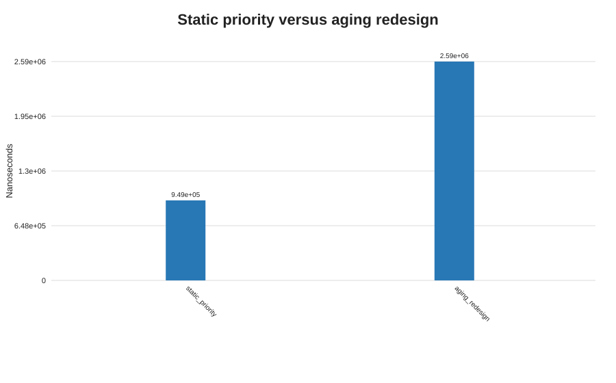

# Q7 - Diagnose, redesign, validate

## D. Prediction (written before implementing the redesign)

The most consequential limitation among Q1-Q6 is Q6's starvation under static severity priority: a continuously replenished higher-priority lane can leave a low-severity patient waiting without a bound. I predict that a one-level-per-1,000-ms aging rule will promote the oldest severity-5 patient to severity-1 after 4,000 ms and select that patient ahead of later-arriving severity-1 patients. The redesign will cost more time and memory because it tracks promotion events and lane entries.

## A. Diagnose the bottleneck (evidence)

In Q6, a severity-5 `Waiting-S5` was behind a backlog of severity-1 arrivals in the static comparator queue. When selection was tested after 5,000 ms, static priority still selected `Urgent-1`, while aging selected `Waiting-S5`. This is a fairness/starvation bottleneck, not a raw collection-speed bottleneck: exchanging the collection without changing the priority policy would not solve it.

## B. Design objective

For a queue with a severity-5 patient and later severity-1 arrivals, guarantee that the waiting patient's effective severity improves every 1,000 ms and becomes level 1 by 4,000 ms. At the 4,000-ms decision point, select that earlier patient ahead of later arrivals now tied at level 1. Keep the queue bounded in space by `O(n)` patient/event records and report the time/space premium over the static design.

## C. Revised design

`StarvationRedesign.java` keeps five `TreeSet` priority lanes. A promotion-event priority queue stores each patient's next scheduled aging time. On poll, all due events are processed: remove the patient from the old lane, decrement its effective level, insert it into the new lane by original arrival order, and schedule the next promotion if needed. The selection rule remains severity first, then arrival sequence.

```text
add(patient):
    insert patient into lane[severity] by arrival order
    schedule promotion at arrival + 1000 ms, if severity > 1

poll(now):
    while earliest promotion is due:
        move that waiting patient up one lane
        schedule its next promotion, unless it reached lane 1
    return the first patient from the highest-priority non-empty lane
```

This avoids a time-varying comparator in a heap (which could invalidate heap order without reheapifying). Balanced-tree lanes allow an aged patient to be removed/reinserted in `O(log n)`. The trade-off is an extra event heap, lane structures, scheduled event objects, and promotion work.

## E. Implement and validate

The exact same 5,000-patient backlog is loaded into each design; there are three warm-ups and twelve timed runs. The static design adds the same patients and polls once. The redesign adds them, processes due events through 4,000 ms, and polls once. The waiting severity-5 patient is the first arrival; the remaining patients have severity 1.

| Design | Average total time | Min-max | Operations* | Estimated objects* | Selected patient |
|---|---:|---:|---:|---:|---|
| Static priority | 948,567 ns | 409,600-2,360,200 ns | 5,001 | 5,001 | Urgent-1 |
| Aging redesign | 2,593,633 ns | 1,284,000-5,783,600 ns | 5,005 | 10,004 | Waiting-S5 |

The redesign took about 2.73 times as long in this small synthetic test and used about twice the estimated queue-related objects. The operation/object counts are transparent estimates (patients, entries, and promotions), not CPU instruction or JVM heap-profiler counts. Runtime memory before/after is also recorded and is GC-sensitive. Full per-run data are in [Q7-results.csv](./Q7-results.csv).



## F. Defend the final design

The prediction was supported: by 4,000 ms, the older severity-5 patient had reached effective severity 1 and was chosen before later severity-1 patients. The redesign's measured latency and object estimate were higher (about 2.73x elapsed time and about 2x estimated queue-related objects), which is an intentional cost paid for a fairness guarantee. If the queue is small and starvation is acceptable or impossible by policy, the original single priority queue is simpler and faster. For production, tune the aging interval with clinical policy, test bursts and simultaneous arrivals, and monitor wait-time percentiles; the synthetic run validates the rule, not a production service-level guarantee.

## Alternative concept and complexity analysis

Static heap add/poll is `O(log n)` and uses `O(n)` space. Aging adds a promotion-event heap and per-level balanced trees; each add, promotion, and selection is `O(log n)`, and storage remains `O(n)` overall because a waiting patient has at most one next promotion event at a time. A timer-wheel/bucket design could reduce promotion overhead for fixed discrete intervals, but adds complexity and interval-boundary bookkeeping. Five FIFO queues alone are faster for fixed priorities, but need explicit promotion bookkeeping to address the diagnosed limitation.
